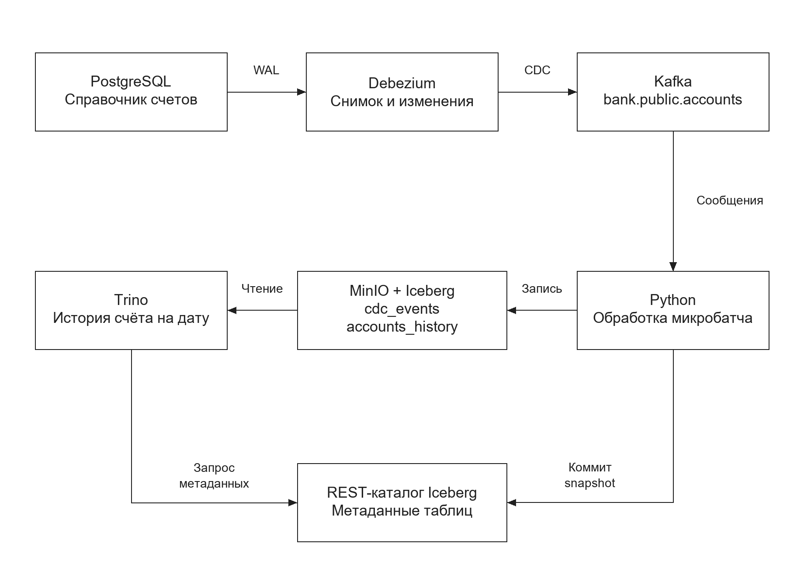

# Отчёт по практической №2

[Оформленная версия этого отчёта со схемой и таблицами в Word](Отчет_практическая_2_Бут.docx).

## 1. Вариант и задача

Работа выполнена по варианту 1, CDC, SCD и Lakehouse [1]. Используется учебный справочник счетов. При изменении владельца или статуса счёта требуется сохранить прежние значения и получить состояние записи на заданную дату. Состав решения и объём данных приведены в таблице 1.

Таблица 1 - Состав решения и объём данных

| Поле | Значение |
|---|---|
| ФИО (как в VK Education) | Бут Иван Антонович |
| Тема | Вариант 1. CDC, SCD и Lakehouse |
| Состав решения | PostgreSQL, Debezium, Kafka, Python, MinIO, Iceberg, REST-каталог и Trino |
| Данные, объём | Вымышленные счета с полями account_id, owner_name и status. 3 счёта в начале, затем смена владельца, блокировка, добавление и удаление счёта. |

## 2. Источники и способы сбора

Источники данных и способы их получения приведены в таблице 2.

Таблица 2 - Источники данных и способы сбора

| Источник | Тип | Способ сбора |
|---|---|---|
| PostgreSQL, таблица public.accounts | Начальный снимок | Debezium один раз читает текущее состояние |
| WAL той же базы | CDC | Debezium получает изменения через pgoutput |
| Kafka, топик bank.public.accounts | Поток событий | Python читает накопившиеся сообщения одним микробатчем |

Debezium выполняет начальный снимок таблицы, затем получает изменения из WAL. Такой способ позволяет отказаться от постоянного полного опроса рабочей таблицы. Аналитические запросы выполняются через Trino к таблицам Iceberg.

В коннекторе указана таблица public.accounts. Для неё включён режим REPLICA IDENTITY FULL, который позволяет получать прежние значения строки, в том числе при удалении [2]. Настройки приведены в [config/accounts.json](config/accounts.json) и [sql/init.sql](sql/init.sql).

## 3. Архитектура

Схема обработки изменений представлена на рисунке 1.



Рисунок 1 - Схема обработки изменений

[Открыть исходник схемы в draw.io](architecture.drawio).

В PostgreSQL хранится текущее состояние счетов. Debezium читает изменения и отправляет их в Kafka. Kafka сохраняет события до обработки. Python собирает из них две таблицы Iceberg в MinIO. В cdc_events лежат исходные события, а в accounts_history история владельцев и статусов.

REST-каталог хранит сведения о таблицах и их snapshots. Через него обработчик публикует результат записи. Trino получает из каталога метаданные и читает сами файлы из MinIO.

### 3.1 Выбор SCD

Для хранения истории выбран SCD Type 2. При смене владельца или статуса старая версия закрывается и добавляется новая. Для каждой версии сохраняются valid_from, valid_to и is_current. Удаление счёта закрывает его последнюю версию.

Type 1 подходит для исправления значения без сохранения прежнего варианта. В Type 6 к историческим версиям добавляют поля с текущими значениями и обновляют их во всех версиях объекта. Для поставленной задачи достаточно Type 2 и запроса по периоду действия.

Начало периода входит в него, конец относится к следующей версии. У текущей версии valid_to пустой. Время определяется по событию PostgreSQL, все отметки указаны в UTC. Доступная история начинается с первого снимка. Порядок событий с одинаковым временем сохраняется в version_offset.

В лекции по Feature Store рассматривается получение исторических значений на момент T [3]. В данной работе сохраняются периоды действия версий счёта. Это позволяет запросить владельца и статус, соответствующие заданному моменту времени.

### 3.2 Обработка и повторы

Для справочника выбрана микробатчевая обработка, поскольку допустима небольшая задержка обновления истории. В учебном примере микробатч запускается вручную и читает доступные сообщения Kafka. Обработчик написан на Python с использованием PyIceberg. При большом потоке целесообразно использовать Spark Structured Streaming с checkpoint и обновлением затронутых ключей через MERGE. Непрерывная обработка подходит для задач с более строгим требованием к задержке.

Сначала события сохраняются в cdc_events, затем пересчитывается история. Проверка ключа topic/partition/offset предотвращает повторную запись одного сообщения. Kafka offset подтверждается после записи истории.

Если обработка остановится между двумя таблицами, следующий запуск пересоберёт историю из сохранённых событий. Два одновременных запуска блокируются общим lock-файлом. Для примера используется один partition и один обработчик. Для большого объёма полный пересчёт в памяти пришлось бы заменить инкрементальной обработкой и настроить репликацию Kafka.

## 4. Docker - что поднялось (честно)

Результаты запуска компонентов приведены в таблице 3.

Таблица 3 - Результаты запуска компонентов

| Блок | Статус реализации |
|---|---|
| PostgreSQL | Реализовано. База запущена, изменения попадают в WAL |
| Debezium | Реализовано. Коннектор и задача в состоянии RUNNING |
| Kafka | Реализовано. События попадают в топик |
| Python | Реализовано. Микробатч выполнен, после обработки контейнер завершает работу |
| MinIO и REST-каталог | Реализовано. Таблицы сохранены, данные и каталог вынесены в volumes |
| Trino | Реализовано. История читается SQL-запросом |

Запуск выполнен из папки работы. Используются Docker Desktop с Linux-контейнерами и Python 3.

```bash
python demo.py
```

Скрипт поднимает сервисы через docker compose up -d, собирает обработчик, регистрирует коннектор, меняет учебные данные и проверяет результат. Отдельный повтор всех сообщений можно запустить так.

```bash
docker compose run --rm worker --replay
```

При первом запуске возникла ошибка записи SQLite-базы каталога из-за прав папки. Служебный контейнер catalog-init назначает владельца папки, а minio-init создаёт bucket. Оба завершаются с кодом 0. После исправления ошибки и перезапуска REST-каталога таблицы сохранились.

Вывод проверки запущенных контейнеров.

```bash
docker ps --filter label=com.docker.compose.project=vk-practice2-but --format "table {{.Names}}\t{{.State}}"
```

```text
NAMES                         STATE
vk-practice2-but-trino-1      running
vk-practice2-but-rest-1       running
vk-practice2-but-connect-1    running
vk-practice2-but-postgres-1   running
vk-practice2-but-kafka-1      running
vk-practice2-but-minio-1      running
```

## 5. Описание

Последовательность обработки приведена в таблице 4.

Таблица 4 - Этапы обработки данных

| Шаг | Для чего | Результат |
|---|---|---|
| Снимок PostgreSQL | Получить начальное состояние | Три исходных счёта |
| Чтение WAL | Получить дальнейшие изменения | События создания, изменения и удаления |
| Kafka | Сохранить поток до обработки | Сообщения с порядковыми offset |
| Python и Iceberg | Сохранить события и собрать SCD Type 2 | Две таблицы в MinIO |
| Trino | Посмотреть историю на дату | Владелец и статус в нужный момент |

После изменений получено 7 событий и 6 исторических версий. Текущих счетов осталось 3. Содержимое таблицы истории приведено в таблице 5.

Таблица 5 - История изменений счетов

| Счёт | Владелец | Статус счёта | Версия SCD |
|---|---|---|---|
| 1001 | Иванов Илья | active | Закрыта |
| 1001 | Соколов Максим | active | Текущая |
| 1002 | Петрова Анна | active | Закрыта |
| 1002 | Петрова Анна | blocked | Текущая |
| 1003 | Смирнов Олег | active | Закрыта |
| 1004 | Орлова Мария | active | Текущая |

У счёта 1001 сохранились прежний и новый владельцы. У счёта 1002 остались оба статуса. Счёт 1003 удалён из рабочей базы, его версия в истории закрыта.

Выполнен запрос за момент до смены владельца счёта 1001. Его результат приведён в таблице 6.

```sql
SELECT account_id, owner_name, status
FROM iceberg.demo.accounts_history
WHERE account_id=1001
  AND valid_from <= TIMESTAMP '2026-11-15 14:30:54.046138 UTC'
  AND (valid_to IS NULL OR TIMESTAMP '2026-11-15 14:30:54.046138 UTC' < valid_to);
```

Таблица 6 - Результат запроса на заданный момент

| Счёт | Владелец | Статус |
|---|---|---|
| 1001 | Иванов Илья | active |

Повторно обработаны все сообщения Kafka. Количество исходных событий осталось 7, исторических версий 6. Содержимое истории до и после повтора совпало. Проверка периодов действия завершилась без ошибок.

Подробные результаты сохранены в [evidence/verification.json](evidence/verification.json), [полная история с датами](evidence/history.csv) и [результат запроса на дату](evidence/point_in_time.jsonl).

## 6. Выводы

Настроен путь данных из PostgreSQL через Debezium и Kafka в Iceberg. Проверены смена владельца, изменение статуса, добавление и удаление счёта. SCD Type 2 сохраняет прежние значения и позволяет получить состояние записи на заданный момент времени.

Повторная обработка сохранила исходный результат без дублирования событий. При увеличении объёма данных полный пересчёт истории следует заменить обновлением затронутых счетов.

## Список использованных источников

1. Практическая № 2. Задание, варианты и форма отчёта / m1705161. GitHub. URL: https://github.com/m1705161/p2 (дата обращения: 16.11.2026).

2. Debezium connector for PostgreSQL. Debezium Documentation. URL: https://debezium.io/documentation/reference/stable/connectors/postgresql.html (дата обращения: 16.11.2026).

3. Занятие 18. Feature Store. Хранилище признаков. Материалы курса «Основы теории информации». НИТУ МИСИС, 2026. 26 слайдов. Слайды 14, 15, 25.
