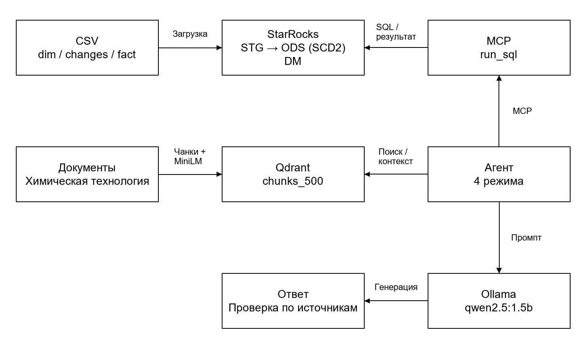

# Лаба 4.5. StarRocks и агент данных

Бут Иван Антонович. Вариант 3, химическая технология. Запуск 16.11.2026.

## 1. Данные и запуск

Использовал CSV и документы из репозитория преподавателя: пять реакторов, три изменения и девять фактов выпуска. В CSV есть числовое поле `value`, единица измерения не указана. Поэтому в своих выводах не приписываю значениям тонны или килограммы.

В StarRocks построил цепочку STG → ODS → DM. Документы нарезаны на чанки по 500 символов с перекрытием 40, из них построено 182 вектора MiniLM. Агент получает схему через MCP, генерирует SQL и передаёт результаты в `qwen2.5:1.5b`. В режиме с документами он дополнительно получает три найденных чанка.



[Редактируемая схема draw.io](architecture.drawio).

В этой версии маршрут задаётся параметром `--mode`. Агент сам генерирует SQL, но выбор между SQL и документами в коде сделан заранее через `none/sql/docs/both`. Полностью самостоятельной маршрутизации здесь нет.

Для запуска добавил [compose.yaml](compose.yaml). Qdrant этой работы использует порт 6334, чтобы не менять коллекции лабы 4. Ollama и кэш MiniLM переиспользуются от лабы 4. Python-контейнер подготовлен из уже установленных библиотек; для сборки с нуля есть [Dockerfile](Dockerfile). Версии сохранены в [requirements-lock.txt](requirements-lock.txt). Исходные команды преподавателя есть в [guide-win.md](guide-win.md).

```powershell
docker compose -p vk-laba45 up -d
docker exec vk45-py python /app/loader.py --domain chemical
docker exec vk45-py python /app/scd2.py --domain chemical
docker exec vk45-py python /app/dm.py --domain chemical
docker exec vk45-py python /app/research.py --domain chemical
docker exec vk45-py python /app/mcp_check.py --domain chemical
docker exec vk45-py python /app/embed.py --domain chemical
docker exec vk45-py python /app/experiment.py
```

Перед первым запуском требуется работающая Ollama на порту 11434 с моделью `qwen2.5:1.5b`, база `dw` в StarRocks и общий volume `vk-rag4_hf-cache`. Готовые контейнеры уже созданы. Для генерации выставлены `temperature=0`, `seed=42`, предел 512 токенов. Модель работала на RTX 3060 Ti, эмбеддинги на CPU.

## 2. Проверка слоёв и истории

| Проверка | Результат |
|---|---|
| STG: справочник / изменения / факты | 5 / 3 / 9 строк |
| ODS: версий справочника | 8 |
| Текущих версий | 5, по одной на реактор |
| DM | 9 строк по реактору и месяцу |
| Некорректных периодов | 0 |
| R-01 на 15.01.2026 | Технолог А |
| R-01 на 15.03.2026 | Технолог В |
| MCP SELECT | Выполнен, получено 9 фактов |
| MCP DROP | Отклонён, таблица сохранена |

История начинается 01.01.2026, изменения применяются с 01.03.2026. У R-01 изменился ответственный, у R-03 и R-04 статус. [Полная проверка](evidence/verification.txt), [запросы](verification.sql), [проверка MCP](evidence/mcp_check.txt).

## 3. Исследование моделей таблиц

Девять исходных фактов повторены 5000 раз, всего 45000 вставок для каждой модели. Время в таблице является минимумом трёх запросов на локальном Docker.

| Модель | Строк после загрузки | Время, мс | Что произошло |
|---|---|---|---|
| Duplicate | 45000 | 8.9 | Сохранила все повторения |
| Primary Key | 9 | 7.9 | Повторные ключи `(id, date)` заменили прежние значения |
| Aggregate | 4 | 5.0 | Значения сложились по четырём id |

Aggregate была быстрее в этом запуске, но разница в несколько миллисекунд зависит от нагрузки. Число строк показывает различие моделей надёжнее. Это логические строки, размер файлов на диске не измерялся.

Суммы у моделей нельзя считать одинаковыми: Duplicate и Aggregate суммируют 5000 повторений, а Primary оставляет один факт на ключ. Значит, ускорение здесь связано ещё и с другой семантикой хранения. [Исходный вывод research.py](evidence/research.txt).

## 4. Шесть вопросов в четырёх режимах

Ответ засчитывал как верный, если он полностью отвечает на вопрос и совпадает с документом или контрольным SQL. Отказ «не знаю» безопаснее выдуманной цифры, но правильным ответом на вопрос с числом его не считал.

| Вопрос | none | sql-only | docs-only | sql+docs |
|---|---|---|---|---|
| Пять групп процессов по кинетическим закономерностям | Нет: выдуманные группы | Нет: ошибочный SQL с неоднозначным status | Верно: все пять групп из документа | Верно по документу, SQL при этом завершился ошибкой |
| Что такое ректификация и за счёт чего она разделяет смеси? | Нет: написал про фильтрующую среду | Нет: нет противоточного массообмена, SQL вернул пусто | Верно: массообмен между паром и жидкостью | Верно по документу, SQL вернул пусто |
| Выпуск R-02 за январь 2026 года | Нет: нужны внешние данные | Нет: SQL зациклился на JOIN, в повторе модель выдала 100 | Нет: «не знаю» | Нет: ошибка SQL, числа 760 нет |
| Кто отвечал за R-01 на 15 января и 15 марта 2026 года? | Нет: выдумал имена | Нет: запросил STG вместо истории, результат пустой | Нет: в документах нет владельцев | Нет: не использовал периоды SCD2 |
| Что такое полимеризация и сколько выпустил R-03 за январь-февраль? | Нет: не указал выпуск | Нет: перепутал полимеризацию с объединением таблиц | Частично: определение есть, числа нет | Нет: SQL с ошибкой, написал 100 млн тонн вместо 1035 |
| Пять групп процессов и выпуск R-01 за январь-март | Нет: отказался отвечать | Нет: выдумал 15000 кг | Частично: группы верные, числа нет | Частично: группы верные, выпуск ошибочно равен нулю вместо 2495 |

Контрольные значения: R-02 за январь = 760, R-03 за январь-февраль = 1035, R-01 за январь-март = 2495. Для истории R-01 правильны Технолог А и Технолог В. Проверил их отдельно от агента, по [verification.sql](verification.sql).

Получилось 24 ответа. Полные тексты и обращения к источникам сохранены в [evidence](evidence/): `doc1_*`, `doc2_*`, `sql1_*`, `sql2_*`, `both1_*`, `both2_*`. В одном запуске `sql1_sql` Ollama вернула HTTP 500. Повторил только этот случай, первый журнал сохранён как `sql1_sql_failed.json`. Ошибки SQL не исправлял внутри основной таблицы.

## 5. Дополнительная проверка контекста

Как обсуждали на занятии, попробовал дать модели более понятный контекст. Указал нужную таблицу, поля и период, запретил JOIN. В схеме для генерации SQL оставил только `ods_fact_chemical`, полученную через MCP. Это отдельный опыт, исходные 24 ответа выше не заменял.

На вопросе про R-02 модель выполнила SUM(value) и ответила **760.0**. В комбинированном вопросе про R-01 запрос тоже вернул правильные **2495.0**, но итоговый ответ перечислил неверные группы процессов и сам добавил единицу «тонн». Значит, сокращение схемы помогло SQL, но не исправило все ошибки генерации. Кроме того, длинная подсказка участвовала в векторном поиске целиком и могла ухудшить подбор контекста.

При написании условий дат модель использовала включённую верхнюю границу, хотя я задал следующий месяц как исключённую. На этих данных разницы нет, потому что на 01.02 и 01.04 строк нет. Это всё равно ошибка, которую на другом наборе нужно исправить.

[Числовой вопрос с подсказкой](evidence/context_numeric.json), [комбинированный](evidence/context_combo.json), [код опыта](context_check.py).

## 6. Итоги и вопросы

### 1. StarRocks и стек MinIO + каталог + Trino

В прошлых работах файлы лежат в MinIO, каталог хранит метаданные Iceberg, а Trino читает их. Здесь StarRocks хранит нативные таблицы и выполняет запросы к ним. Для изменения измерения используется Primary Key таблица с UPDATE и INSERT. Ограничения записи в Iceberg из гайда относятся к использованному в лабе контуру и версии, а не ко всем возможностям формата Iceberg.

### 2. Слои

STG соответствует Bronze: исходные данные без историзации. ODS соответствует Silver: согласованный справочник и факты. DM соответствует Gold: агрегаты под запросы. SCD2 хранится в ODS, потому что историю объекта нужно сохранить до построения отдельных витрин. В STG остаётся исходная загрузка, в DM часть детализации уже потеряна.

### 3. SCD2 без MERGE

Скрипт закрывает текущую версию через UPDATE, записывает `valid_to` и снимает `is_current`. Затем вставляет новую строку с новым `sk`. Код объекта `id` остаётся тем же, а `sk` различает его версии. Период считаю полуоткрытым: начало включено, конец нет.

```sql
SELECT id, owner, status
FROM dw.ods_dim_chemical
WHERE valid_from <= '2026-01-15'
  AND (valid_to IS NULL OR valid_to > '2026-01-15');
```

Для R-01 этот запрос даёт Технолог А. На 15.03.2026 даёт Технолог В. Текущую запись нельзя использовать вместо исторической. Это тот же смысл point-in-time, который обсуждался на лекции о Feature Store: запросу на прошлую дату нужны значения, действовавшие тогда.

В учебном скрипте закрытие и вставка выполняются последовательно с autocommit. Атомарность пары при сбое здесь не проверялась; для рабочего конвейера её надо обеспечить отдельно.

### 4. Выбор модели таблицы

Duplicate сохраняет исходные события, Primary позволяет менять конкретную версию измерения по `sk`, Aggregate заранее складывает показатели по ключу витрины. В опыте число строк сократилось с 45000 до 9 или 4, но с разными правилами обработки повторений. Выбирать модель только по скорости без учёта этих правил нельзя.

### 5. SQL, документы и MCP

Числа и история владельцев находятся в SQL, определения процессов в документах. MCP даёт агенту единый инструмент `run_sql`, через который он узнаёт схему и выполняет запросы, вместо заранее вшитого SQL. Но хороший интерфейс не гарантирует правильный запрос. В этой реализации режим выбирается параметром, а не решением модели. Вопрос про владельца R-01 на две даты требует SCD2 и условий по периоду, обычного чтения текущего справочника недостаточно.

### 6. Где модель ошиблась

Без инструментов модель выдумала группы процессов и владельцев реактора. Только SQL часто давал неверные JOIN, пустые выборки или ошибки полей. Только документы помогли с определениями, но не содержали текущих производственных цифр. Совместный режим правильно ответил на два вопроса по документам, однако не справился с числами в основном опыте. Особенно заметно, что пустой результат модель иногда превращала в ноль, а SQL-ошибку могла сопровождать выдуманным числом.

После подсказки SQL смог вернуть 760 и 2495, но итог комбинированного ответа всё равно остался неверным. Для такого агента нужно проверять и запрос, и найденный контекст, и финальный ответ. Наличие RAG само по себе не делает ответ правильным.

Задание: https://github.com/m1705161/laba4.5. Шесть вопросов и состав отчёта взяты из разделов 7, 9 и 10 [гайда](guide.md).
